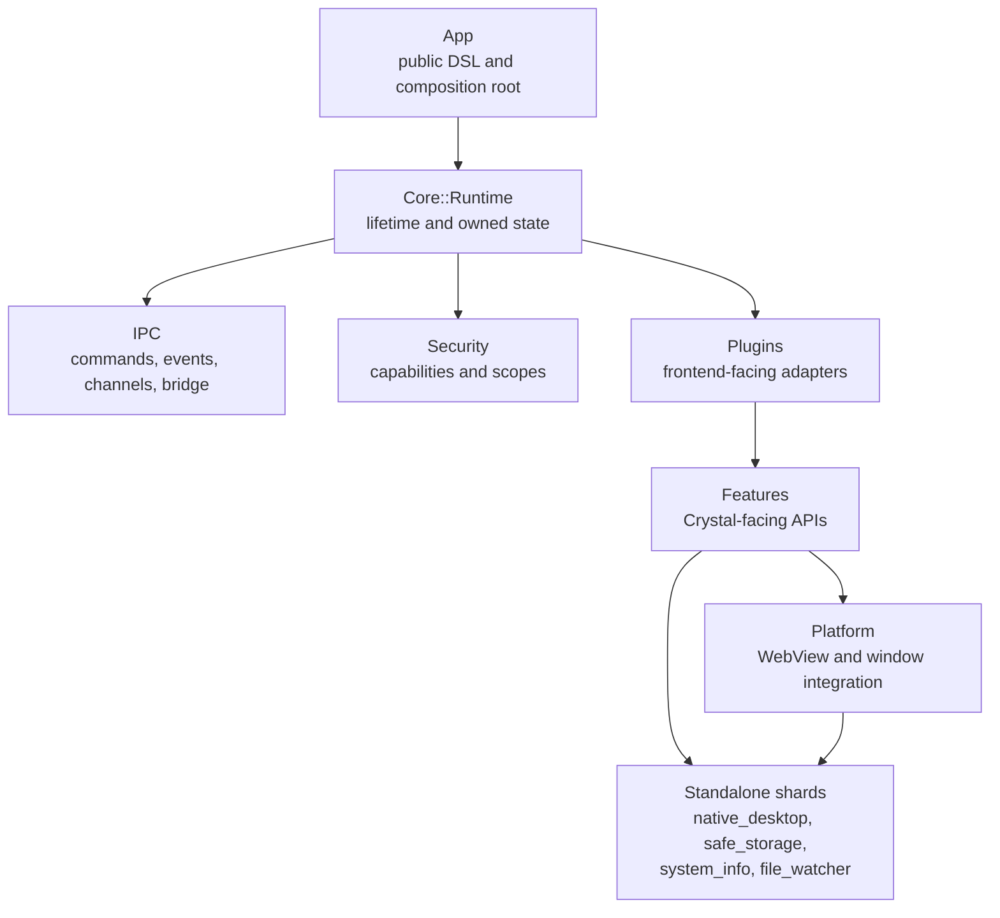

# CrystKit Source Reading Path

This guide is for contributors who want to understand the repository rather than only use the public API. Read the runtime from its composition root outward, then follow the subsystem relevant to your change.

## Runtime Overview



CrystKit’s feature and plugin APIs are the framework boundaries. Standalone shards provide native controls, credential storage, host information, and file watching.

## Suggested Reading Order

1. `src/crystkit.cr` shows the complete require graph.
2. `src/app/app_config.cr` defines runtime configuration.
3. `src/app/app.cr` is the public composition root. Start with `#command`, `#plugin`, `#window`, `#emit`, `#run`, and `#shutdown`.
4. `src/core/runtime.cr` shows the services and app-owned features that live for the duration of an application.
5. `src/core/window.cr`, `src/core/native_window.cr`, and `src/core/window_registry.cr` form the window stack.
6. `src/core/main_thread.cr` and `src/core/fibers.cr` explain the UI execution context and the parallel context used for non-GUI work.
7. `src/core/errors.cr` defines the framework error hierarchy and stable error codes.

After that, choose a subsystem.

## IPC

Read these files in order:

1. `src/ipc/schema.cr` — request and response envelopes.
2. `src/ipc/codec.cr` — JSON conversion.
3. `src/ipc/command.cr` — typed handler construction.
4. `src/ipc/policy.cr` and `src/ipc/policy_resolver.cr` — command authority.
5. `src/ipc/router.cr` — registration, invocation, events, and timeouts.
6. `src/ipc/channel.cr` — ordered streaming.
7. `src/ipc/js_bridge.cr` — the injected frontend client.

The useful end-to-end path is:

```text
frontend invoke
  -> JS bridge
  -> router
  -> policy resolver
  -> security context
  -> typed handler
  -> response envelope
```

See [IPC](ipc.md) for the public behavior.

## Security

Start with:

1. `src/security/capability.cr`
2. `src/security/scope.cr`
3. `src/security/scopes/base_scope.cr`
4. `src/security/scopes/loader.cr`
5. `src/security/manifest.cr`
6. `src/security/permission_prompt.cr`
7. `src/security/context.cr`

Capability checks answer whether an operation is allowed. Scopes constrain which path or resource it may affect. The manifest loads application authority; plugin metadata declares the authority required by frontend commands.

See [Security](security.md) before changing policy semantics.

## Plugins

Plugins expose commands and events to the frontend. Features expose Crystal APIs to application and plugin code.

Read:

1. `src/plugins/base.cr`
2. `src/plugins/registry.cr`
3. `src/plugins/builtins.cr`
4. one matching pair such as `src/plugins/builtins/dialog.cr` and `src/features/dialog.cr`

A built-in plugin should declare metadata and policy, construct or obtain the corresponding feature, register commands, and release owned resources during cleanup.

See [Plugins](plugins.md) for the authoring contract.

## Features and Standalone Shards

Feature files under `src/features/` are the CrystKit-facing boundary. Some contain the complete implementation; others adapt a standalone shard to CrystKit security, execution contexts, lifecycle, and JSON-facing models.

Implementation ownership:

| CrystKit adapter | Implementation owner |
| --- | --- |
| `src/features/file_watcher.cr` | `file_watcher` |
| `src/features/safe_storage.cr` | `safe_storage` |
| `src/features/system_info.cr` | `system_info` |
| dialogs, clipboard, speech, tray, toolbar, shortcuts, hardware, and other desktop controls | [`native_desktop`](https://github.com/naqvis/native_desktop/tree/main/guides) |

Applications built with CrystKit use `CrystKit::Features` from Crystal code and `CrystKit::Plugins` from frontend code. The adapters add framework capabilities and lifecycle management.

Good examples of different feature shapes:

- `src/features/fs.cr` for capability and path-scope enforcement
- `src/features/dialog.cr` for a GUI-bound native service
- `src/features/file_watcher.cr` for a shard event stream bridged onto CrystKit’s background execution context
- `src/features/safe_storage.cr` for credential storage with framework security and lifecycle management
- `src/features/toolbar.cr` for a window-owned model synchronized to a native provider

## Platform Layer

The remaining `src/platform/` code is deliberately narrow. It owns integration that is coupled to CrystKit’s WebView host:

- creating and driving WebView windows
- dispatching native loop work
- custom `crystkit://` protocol handling
- WebView DevTools and permission wiring
- enhanced window behavior
- WebView printing
- NSPanel integration

Start with `src/platform/services.cr` and the interfaces under `src/platform/backends/`. Then follow only the backend involved in your change.

Do not add a general desktop control directly to `src/platform/<os>/`. Add it to `native_desktop` and expose it through a CrystKit feature or plugin. Keep code in CrystKit only when it depends on CrystKit window ownership, WebView behavior, IPC, or security.

## Builder

The builder is independent of the runtime path:

1. `src/builder/cli.cr` — command dispatch
2. `src/builder/config.cr` — project configuration
3. `src/builder/build.cr` — Crystal build orchestration
4. `src/builder/commands/` — individual commands
5. `src/builder/bundle/bundler.cr` — package dispatch
6. `src/builder/bundle/<platform>/` — native package formats
7. `src/builder/scaffold/` — embedded starter project

Use `crystkit --help` and each subcommand’s `--help` as the current CLI reference.

## Testing

`spec/spec_helper.cr` loads the headless harness and test providers. Useful starting points are:

- `src/test/fake_frontend.cr` for IPC without a WebView
- `src/test/fake_window_backend.cr` for window lifecycle without a native window
- `src/test/fake_window_integration_backend.cr` for DevTools and permission integration
- provider fakes in `src/test/` for clipboard, speech, toolbar, theme, power, idle, CPU, and DPI

Read the production class beside its spec. The file names in `spec/` intentionally mirror the feature or subsystem they exercise.

See [Testing](testing.md) for examples.

## Common Change Locations

| Task | Start here |
| --- | --- |
| Add an application command | `src/app/app.cr` |
| Add a plugin command | `src/plugins/base.cr` and a similar file in `src/plugins/builtins/` |
| Add a CrystKit feature adapter | `src/features/` |
| Add a general native desktop control | the `native_desktop` shard, then a CrystKit feature/plugin adapter |
| Change WebView or native-window integration | `src/platform/backends/` and the matching `src/platform/<os>/` file |
| Add a security scope | `src/security/scopes/base_scope.cr` and `src/security/scopes/loader.cr` |
| Change the IPC wire format | `src/ipc/schema.cr`, `src/ipc/codec.cr`, and `src/ipc/js_bridge.cr` |
| Debug a UI dispatch hang | `src/core/main_thread.cr`, `src/core/fibers.cr`, and the host message-loop adapter |
| Add a builder command | `src/builder/cli.cr` and `src/builder/commands/` |

## Related Guides

- [Architecture](architecture.md)
- [IPC](ipc.md)
- [Security](security.md)
- [Plugins](plugins.md)
- [Testing](testing.md)
- [Cross-platform support](cross-platform.md)
